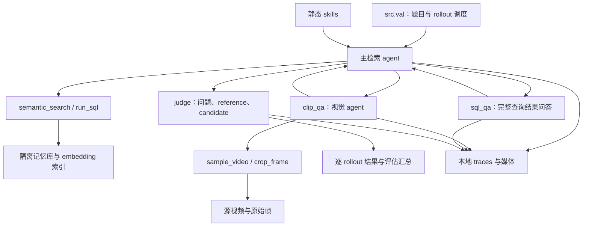

# 问答 Harness 与 Trace2Skill baseline

当前 worktree 为 `/raid/wg25r/video_sql_2`，分支 `codex/trace2skill-baseline`。Luna baseline 已按用户要求暂停，保留 80 条完成 rollout，充值后再继续。当前配置、旧数据核对、指标和恢复步骤见新文档 [TRACE2SKILL_LUNA_HANDOFF.md](TRACE2SKILL_LUNA_HANDOFF.md)。

这个 harness 使用静态检索技能回答长视频问题。主 agent 在预先构建的 DuckDB 记忆库和 embedding 索引中定位线索，按需调用视觉 agent 检查源视频，再提交开放式答案。评估入口为每道题运行多个独立 rollout，并用 judge 评分。

问答期间 skills 只读，不进行 reflection 或技能更新。当前 baseline 的技能学习由 `src.trace2skill_baseline` 在采集完成后交给上游 Trace2Skill Combined 执行，再冻结技能做训练集复评。主检索、视觉问答、SQL 问答、judge 和技能分析均使用 OpenAI 官方 Responses API；embedding 使用独立的 Qwen3-VL-Embedding-8B 服务。

## 1. 架构与代码入口



| 路径 | 职责 |
| --- | --- |
| [src/harness.py](../src/harness.py) | Agent 配置、检索工具、视频采样与裁剪、证据引用、compaction、trace 保存 |
| [src/val.py](../src/val.py) | CLI、批次调度、rollout/judge 重试、结果恢复、评分、W&B/Weave |
| [src/trace2skill_baseline.py](../src/trace2skill_baseline.py) | 当前 baseline：266 道 month 训练题 × 5 条 rollout、Combined 分析、一次 evolution、冻结技能后的同集复评 |
| [third_party/trace2skill/baseline_evolve.py](../third_party/trace2skill/baseline_evolve.py) | 固定版本上游 Trace2Skill 的目录、Responses structured-parse 和 evolution 桥接 |
| [src/normalize.py](../src/normalize.py) | 输入文本归一化 |
| [src/prepare_runtime.py](../src/prepare_runtime.py) | 从已有总库与索引导出按 timeline 隔离的运行数据 |
| [skills/initial/](../skills/initial/) | ROOT-SKILL 与六个静态检索技能 |
| [docker/harness/Dockerfile](../docker/harness/Dockerfile) | Python 运行环境、依赖、ffmpeg 和 git |

直接集成时可使用 `VideoSQLHarness`：构造参数包括数据库、embedding 索引、媒体映射、skills、输出目录、模型名、API key 和 embedding 服务配置。调用 `await harness.answer(question)` 得到 `RolloutSession(answer, status, trace_files)`，使用后调用 `await harness.close()`。这个接口负责答题；judge、评估汇总和 W&B/Weave 初始化由 `src.val` 负责。RolloutSession 的 trace_files 列出主检索和 compaction 段；子调用也写入 traces 目录，评估入口保存结果时统一收集全部阶段的 segment JSON。

## 2. 依赖与模型配置

需要 Python 3.12 或以上、git、ffmpeg，以及 [pyproject.toml](../pyproject.toml) 和 uv.lock 中的依赖。在仓库根目录安装：

```bash
uv sync --frozen --no-dev
```

评估入口从**项目根目录的 .env 文件**读取密钥，默认字段为：

```dotenv
PERSONAL_OPENAI_KEY=YOUR_OPENAI_API_KEY
```

这里使用 `dotenv_values` 直接读取文件；仅在 shell 中 export 同名变量不能替代该文件。密钥不写入 run 配置或本地 trace。

主检索、视觉、SQL 问答和 judge 共享以下设置：

| 配置 | 值或行为 |
| --- | --- |
| API endpoint | 当前 baseline 使用 `https://api.openai.com/v1` |
| 默认模型 | `gpt-5.6-luna` |
| SDK | OpenAI Agents SDK 的 `OpenAIResponsesModel` |
| Reasoning | `effort=high`、`summary=auto` |
| Responses 存储 | `store=false` |
| Reasoning 返回 | `response_include=["reasoning.encrypted_content"]` |
| Reasoning item IDs | `reasoning_item_id_policy=preserve` |
| 请求重试 | OpenAI client 的 `max_retries=3` |
| 生成参数 | 不设置 temperature、top_p 或输入/输出 token 上限 |

正常工具轮次保留完整 Responses items，历史导出使用 `result.to_input_list()`。模型返回的 reasoning summary 可阅读；encrypted reasoning 是供 API 延续上下文的不透明内容，两者均保存在本地 trace。Agents SDK tracing 已启用，baseline 通过 `WeaveTracingProcessor` 把 agent/tool spans 发到 Weave。

当前 baseline 的实际请求共享 256 个并发名额，包括嵌套 agent、judge、embedding 和 replacement token counting。HTTP connect timeout 为 60 秒，read/write/pool timeout 为 100000 秒；最大连接数 1000，keep-alive 256。

Embedding 服务须提供兼容的 `POST /v1/embeddings` 接口。配套配置为：

```text
URL:   http://127.0.0.1:8014/v1
model: qwen3-vl-embedding-8b
```

Harness 发送单个归一化文本查询，读取一个 4096 维有限值向量，并与已有索引向量做点积排序。服务模型必须与索引匹配；评估入口不会启动 embedding 服务、重新生成向量或部署本地答题模型。

评估还要求运行环境已登录 W&B，并有 `3dsmile/video-sql-v2` 的访问权限。W&B 和 Weave 的 entity/project 在入口中固定，初始化失败不会被忽略。

## 3. 输入数据与隔离

### 题目文件

`--test-file` 指向 JSON 数组。每项必需字段如下，例子仅展示格式：

```json
[
  {
    "index": 1,
    "timeline": "day",
    "question": "画面中的人把杯子放在哪里？",
    "answer": "桌上"
  }
]
```

`timeline` 选择运行数据子目录，`index` 标识该 timeline 内的题目；二者共同构成题目身份。同一题目的多个 rollout 分别编号，从 0 开始。仓库配套评估文件为 `data/test-seed-0.json`。

主 agent 获得问题文本、当前隔离库的 schema、ROOT-SKILL 和其他技能的名称/描述；reference answer 只传给 judge。输入中的其他标注字段不会传给答题 agent。

主 agent 的问题、语义查询、子问题和 notes 使用 `normalize_text`：NFKD、移除组合标记、映射常见引号/破折号等标点、转小写并折叠空白，保留中文等非 ASCII 字符。Judge 接收题目文件中的原始问题。

### 运行数据目录

```text
data/runtime/
├── day/
│   ├── index.duckdb
│   ├── media-map.json
│   └── embedding_index/
│       ├── episodes.row_ids.npy
│       ├── episodes.vectors.npy
│       └── <其余六张检索表的 row_ids/vectors 文件>
├── week/
│   └── <相同结构>
└── month/
    └── <相同结构>
```

每张检索表的 `row_ids.npy` 与 `vectors.npy` 按行对应；通过 NumPy mmap 加载。运行库应已按 timeline 隔离，移除用于区分其他 timeline 的数据库字段和 row ID 前缀。这个隔离由数据准备阶段完成，评估入口直接使用已有文件。

`media-map.json` 的顶层为 `{"sources": [...]}`。每个 source 包含 `source_video_id`、`path`、`duration_s`、`timeline_start_s` 和 `timeline_end_s`。Sources 按逻辑时间排序，`path` 指向实际媒体文件；所有工具时间均使用映射中的连续逻辑时间轴，单位为秒。

默认部署使用 `/raid/huggingface` 作为 HF cache。媒体文件的真实路径由 media-map 决定，不能仅根据视频名拼接路径。运行环境或容器必须能访问映射中的路径。

### 记忆库

| 表 | 内容及主要关联 |
| --- | --- |
| `episodes` | 不同粒度的文本描述；`row_id, start_s, end_s, granularity, text` |
| `entities` | 实体名称、首次/末次出现时间与频率 |
| `semantic_triples` | `subject/predicate/object`、`snapshot_s`，通过 `caption_30sec_row_id` 关联描述 |
| `topic_chains` / `topic_facts` | 主题链与事实，事实通过 `chain_row_id` 关联链 |
| `event_chains` / `event_steps` | 事件链与步骤，步骤通过 `chain_row_id` 关联链 |
| `visual_clips` | 带起止时间的视频片段描述 |
| `object_states` | 物体状态与所属 3 分钟、30 秒描述 |
| `graph_edges` | row ID 之间的关系与权重 |
| `topic_fact_evidence` | `fact_row_id → caption_30sec_row_id` |
| `event_step_evidence` | `step_row_id → caption_30sec_row_id` |

完整字段列表在 `src/harness.py` 的 `SCHEMA` 和 [sql-schema skill](../skills/initial/sql-schema.md) 中。

## 4. 静态 skills 与主 agent 工具

ROOT-SKILL 自动注入主 agent 指令。其他技能通过 Markdown frontmatter 中的 `name` 和 `description` 建立目录，模型调用 `read_skill(name)` 后才取得全文。

| Skill | 用途 |
| --- | --- |
| `general-retrieval` | 调查规划与多来源检索 |
| `semantic-search` | 按概念定位候选内容 |
| `sql-schema` | 查询字段、关联和证据链接 |
| `locating-time-intervals` | 时间锚点、前后关系和区间 |
| `counting-and-ordering` | 去重、计数、顺序和排名 |
| `visual-verification` | 检查可见细节、文字、状态与动作 |

| 主工具 | 输入 | 返回与用途 |
| --- | --- | --- |
| `semantic_search` | `query, table, n, rank_start, min_score, max_score` | 候选 row ID、时间、文本 preview 和相似度得分 |
| `run_sql` | `sql` | `columns, rows, has_more`，查询结果预览 |
| `sql_qa` | `sql, question` | 把完整 SQL 结果交给无工具的子模型，返回文本答案 |
| `clip_qa` | `start_s, end_s, question` | 视觉答案、证据时间及图像 |
| `add_note` / `read_notes` | `note` / 无参数 | 保存和读取该 attempt 的调查笔记 |
| `read_skill` | `name` | 指定静态 skill 的完整 Markdown |
| `replace_tool` | `tool_id, replacement` | 用文本替换任意已完成工具的模型可见返回，原始返回保留在 trace |
| `agent_raise` | `reason` | 抛出 AgentRaised，结束当前 attempt，交由 rollout 重试层处理 |
| `submit_answer` | `answer` | 提交答案并停止检索 loop |

每个工具返回携带整数 `tool_id`，在同一 rollout attempt 内与嵌套 agent 共用编号。`replace_tool` 可删除错误工具调用产生的无用输出，或总结冗余结果，包括含图像的输出；工具说明建议优先替换最新结果以保留 KV cache 前缀。替换只影响后续模型输入，不撤销副作用；完整原始输出和 replacement 调用供 Trace2Skill 分析使用。

`semantic_search` 支持 `episodes.text`、`entities.name`、`semantic_triples.text`、`topic_facts.fact`、`event_steps.description`、`object_states.text` 和 `visual_clips.text`。先按包含边界的 min/max score 过滤，再按降序取 rank 范围；`rank_start` 从 1 开始，`n` 必须为正，无分数边界使用 JSON `null`。Preview 最多保留 500 字符，长文本同时附原长度；需要全文时可查询原行。

SQL 连接只读，禁用外部访问和未签名扩展。语句开头只接受 SELECT、WITH、DESCRIBE、SHOW，执行超时为 30 秒。同名输出列会显式报错，JOIN 时应使用不同 AS 别名。

`run_sql` 最多返回 100 行，长字符串单元格表示为 `{"value": "...", "original_length": N}`。这只是工具返回的预览结构，数据库原列仍是字符串。`sql_qa` 则读取全部行和完整字符串，不做 50k 等字符截断；输入超过 API 容量时返回错误，不自动缩减结果。

## 5. 视频采样、裁剪与证据

每次 `clip_qa` 创建独立视觉 agent、帧记录表和图片额度。区间必须有限、非负、递增，长度不超过 1200 秒。视觉 agent 可多次采样、裁剪和记录 notes，但不能使用主 agent 的数据库检索工具。

### 视觉工具

`sample_video(sample_start_s, sample_end_s, fps, include_captions, crop_left, crop_top, crop_right, crop_bottom)`：

- 采样区间必须位于本次 clip_qa 内，fps 必须有限且大于零。
- 返回独立帧图像，每帧附 `frame_id, time_s, filename, crop`。
- 返回本次 `frame_count`、累计 `images_used` 和 `remaining_images`。
- 开启 captions 时，附带与采样区间重叠的 30 秒级 episodes 全文；这些是记忆库描述，不是临时运行 ASR。

`crop_frame(frame_id, crop_left, crop_top, crop_right, crop_bottom)` 从已返回帧的原始分辨率 PNG 裁剪，生成新 frame ID，保留源帧时间并记录 `parent_frame_id`。即使传入的是先前裁剪图的 ID，坐标也仍相对于原始完整画面。

所有 crop 坐标使用 0–1000 单位：

```text
0 ≤ left < right ≤ 1000
0 ≤ top < bottom ≤ 1000
完整画面：left=0, top=0, right=1000, bottom=1000
```

模型收到的图像为保持比例、最大 854×480 的 JPEG，quality=90、detail=high；原始 PNG 单独保存。缩放上限作用于每一帧或裁剪图。

`add_clip_note(note)` 和 `read_clip_notes()` 保存与读取该 clip 的文字笔记。

### 帧时间与证据提交

ffmpeg 使用保留源 PTS 的 select 和 passthrough 同步方式选择帧。程序读取 showinfo 的整数 PTS 与 time base，按以下公式换算：

```text
time_s = source.timeline_start_s + pts × time_base_num / time_base_den
```

时间不是通过 `sample_start_s + frame_index / fps` 推算。采样跨越多个 source 时分别读取各 source 的时间戳；实际采样数由源帧选择决定。

视觉 agent 通过 `submit_clip_answer(status, answer, evidence_frame_ids)` 提交：

- `status` 为 `answered` 或 `unknown`。
- `answered` 必须至少引用一个本 clip 已返回的 frame ID。
- 任何引用都必须属于本 clip；无效提交作为工具错误返回，允许模型纠正。

主 agent 收到 `status, answer, evidence_times_s`；answered 结果还包含对应证据图及其 frame ID、文件名和 crop。证据时间由帧记录派生，图片直接读取已经发送给视觉 agent 的 JPEG，不按时间重新 seek。模型可见的图像元数据不包含宿主机路径，完整路径留在本地媒体记录。

### 累计图片额度

每个 clip_qa 最多累计返回 **650 张图片**，没有 30 张限制。采样和裁剪共用额度与异步锁，并行请求也串行检查和更新计数。重复调用工具重新发送图像会消耗新额度；SDK 重放已有历史不重新计数，`replace_tool` 不返还累计采样额度。这是保留的 harness 额度，不是 Luna 的模型容量声明。

超额请求整体返回错误和剩余额度，不部分返回、不自动降低 fps 或缩短区间。额度在整次图片工具返回准备成功后更新；被拒绝请求可能已经在磁盘留下解码产物，但不会将其作为部分成功结果交给模型。

视觉 agent 不做 compaction。图片额度控制图片输入的增长，不能保证任意长文本和 reasoning 都不会触及上下文上限；工具或 API 错误会显式记录。

## 6. 上下文与结束条件

每次 `Runner.run_streamed` 最多执行 100 轮。主 agent 根据每次 completed response 的 usage 计算：

```text
remaining = 314573 - input_tokens - output_tokens
```

当 remaining ≤ 178,000 时，请求在当前轮结束后 compaction。若同轮已经产生有效最终答案，先接受答案。

Compaction 使用同一个主 Agent 和原会话，临时移除工具，要求生成保留问题、证据和后续调查步骤的 handoff。前两次生成后，以 handoff 开始新的上下文并继续；第三次生成后返回 `compaction_limit`，得分 0，不调用 judge。视觉 agent、sql_qa 和 judge 不做 compaction。

模型容量、compaction 余量和图片额度是源码常量；它们不会随 `--model-name` 自动调整，也不是请求中的 token 限制。

流结束后还会检查：排除 reasoning 并规范化 item IDs 等字段后，如果连续三次 completion 完全相同，抛出 InvalidTrace。模型未按提交格式结束时，按实际结构化输出校验错误处理。

## 7. 独立评估入口

本节是 `src.val` 的独立评估接口，不是当前 Trace2Skill baseline 的恢复命令。当前暂停 run 的恢复入口和前台 embedding 启动步骤见 [新交接文档](TRACE2SKILL_LUNA_HANDOFF.md#训练协议与恢复行为)；当前不启动 held-out 评估。

在仓库根目录运行。以下为新评估目录的启动示例；embedding API、数据、.env 和 W&B 登录应已准备好：

```bash
mkdir -p runs/training-free-example
PYTHONUNBUFFERED=1 HF_HOME=/raid/huggingface .venv/bin/python -m src.val \
  --test-file data/test-seed-0.json \
  --runtime-root data/runtime \
  --run-dir runs/training-free-example \
  --skill-dir skills/initial \
  --model-name gpt-5.6-luna \
  --api-key-env PERSONAL_OPENAI_KEY \
  --embedding-url http://127.0.0.1:8014/v1 \
  --embedding-model qwen3-vl-embedding-8b \
  --batch-size 30 --rollouts 5 --attempts 3 \
  > runs/training-free-example/eval.log 2>&1
```

| CLI 参数 | 必需或默认值 | 含义 |
| --- | --- | --- |
| `--test-file` | 必需 | 题目 JSON |
| `--runtime-root` | 必需 | 包含各 timeline 的运行数据根目录 |
| `--run-dir` | 必需 | 结果、traces 与配置的保存目录 |
| `--embedding-url` | 必需 | Embedding API 的 /v1 base URL |
| `--embedding-model` | 必需 | Embedding 服务中的模型名 |
| `--skill-dir` | 项目 `skills/initial` | 静态技能目录 |
| `--model-name` | `gpt-5.6-luna` | 所有 LLM 角色使用的模型名 |
| `--api-key-env` | `PERSONAL_OPENAI_KEY` | 项目 .env 中的字段名 |
| `--batch-size` | 30 | 每批题目数 |
| `--rollouts` | 5 | 每题独立答题次数 |
| `--attempts` | 3 | 每个 rollout 的 attempt 上限及每次 judge 的尝试上限 |

题目按输入文件顺序分批。一批创建 batch_size × rollouts 个任务，并使用同样大小的 semaphore；默认最多 150 个并发 rollout。一批全部结束后才调度下一批。每个 rollout 完成答题和 judge 后立即保存 result.json，不等整个 batch 结束。实际 API 请求量还受每个 rollout 的工具调用与提供方限流影响。

Docker 镜像可以用 `docker build -f docker/harness/Dockerfile -t video-sql-harness .` 构建。镜像包含源码、skills、Python 依赖、ffmpeg 和 git，入口为 `.venv/bin/python`，因此容器参数从 `-m src.val` 开始。运行时需提供 .env、运行数据、media-map 所指向的媒体路径、可写的输出目录、W&B 登录及有效 Git 工作区；入口会执行 `git rev-parse HEAD`，镜像自身没有复制 .git。访问宿主机的 127.0.0.1 embedding 服务时，需匹配容器网络配置，例如使用 host 网络。容器保留命名实例，不使用 `--rm`。

## 8. Judge 与指标

Judge 的输入是 JSON，包含 `question`、`reference_answer` 和 `candidate_answer`，输出为 `submit_judgment(score)`，score 是 0–5 的整数。评分依据问题语境中的语义等价：5 表示完全等价，0 表示错误，中间整数表示部分正确。若 reference 是选项编号，judge 利用原问题解释编号；附带的视频 ID、时间戳和 row ID 不作为答案对错依据。

结果状态如下：

| status | 含义 | score |
| --- | --- | --- |
| `answered` | 答案提交与 judge 均完成 | Judge 给出的 0–5 分；不代表答对 |
| `compaction_limit` | 达到第三次主 agent compaction | 0 |
| `failed` | Rollout 的可重试 attempts 耗尽 | 0 |

非可重试错误会向上抛出，可能使评估在没有最终汇总的情况下退出；已有逐 rollout 结果仍保留。

入口记录的 `accuracy` 是：

```text
accuracy = sum(score) / (5 × rollout 数)
```

分母包含 failed 与 compaction_limit；它不是“满分 rollout 比例”。从逐 rollout 文件还可另行计算：

- 满分比例：`count(score > 4) / rollout 数`。
- 至少一次满分的题目比例：按 `(timeline, question_index)` 分组，统计至少一个 rollout 得分 >4 的题目数，再除以题目数。

这两个额外比例不由入口自动写入汇总。统计时只读取 `val/question-*/rollout-*/result.json`，避免把归档、attempt traces 或 W&B 恢复后的重复日志当成额外样本。

## 9. 重试与恢复

本节描述 `src.val`。Baseline 直接复用完成的 `result.json`，已有 `answer.json` 时复用答案继续 judge，无答案的中断 attempt 归档后重新执行；W&B 使用固定 run ID 和 `resume="allow"`。其完整恢复规则见 [新交接文档](TRACE2SKILL_LUNA_HANDOFF.md#训练协议与恢复行为)。

SDK 请求重试和评估层重试是两层独立机制。评估层最多执行 `--attempts` 次 rollout；每次成功答题后的 judge 也有自己的 `--attempts` 次机会。可重试类别包括模型输出校验、InvalidTrace、AgentRaised、SDK 轮数/模型行为错误，以及代码列明的连接、超时、限流和服务端错误。重试不切换模型或 reasoning。

普通工具校验和执行错误通常返回 error JSON 供模型纠正。余额不足或 `insufficient_quota` 会沿异常链识别、从通用工具错误处理向上抛出，并被评估层判为不可重试。错误文件保留异常链，stdout 同时打印原因。

使用相同 run-dir 和原参数可恢复评估；stdout 日志应写入新文件，避免覆盖旧日志。恢复规则是：

1. 已存在 rollout 的 `result.json` 就直接读取，包括 status=failed 的结果。
2. 缺少 result.json 时，跳过已有 `attempt-N/error.json` 的 attempt，继续下一个可用编号。
3. 没有完成也没有 error.json 的 attempt 会重新运行答题流程，**不会从最后一个工具调用继续会话**。
4. 同一个 run 的 W&B ID 从 config.json 读取，使用 `resume="must"`；新 run 使用 `resume="never"`。

恢复时仍使用本次 CLI 参数；config.json 不会自动覆盖这些参数，也不会验证它们是否与旧 run 一致。应保持题目文件、模型、skills、数据和 rollout 设置一致。config.json 中的 Git hash 和配置记录是该 run 创建时的值。

如果明确需要重新执行已有 failed 结果，应先保留并归档对应 rollout 的完整目录及旧汇总，再恢复缺失项；只移走 result.json 会留下已耗尽的 attempt 错误，可能再次直接得到 failed。Trace 中的媒体路径沿用 run-dir 的绝对或相对形式；相对路径按原工作目录解析，归档或移动目录后还需对应到新位置。不要将归档副本放进活动 `val/question-*/rollout-*` 的统计范围。

## 10. 结果、完整 trace 与日志

旧 GPT-5.6-Luna 的完整评估产物位于 [training_free_luna_seed0_7510e535](/raid/wg25r/video_sql_v2/runs/training_free_luna_seed0_7510e535/)，汇总见 [result.json](/raid/wg25r/video_sql_v2/runs/training_free_luna_seed0_7510e535/result.json)。这是 seed-0 评估集的 day/week/month 各 100 题 × 5 条，共 1,500 条；其中 month 的 100 题与本次 266 题训练集没有题目 ID 或问题文本重合。不能把它当作完整的 month 训练轨迹。逐 rollout 结果位于 `val/question-<timeline>-<index>/rollout-<N>/result.json`；对应 attempt 的完整 trace 和图像分别在 `attempt-<N>/traces/` 与 `attempt-<N>/media/`。

当前 baseline 的产物位于 [trace2skill-baseline-openai-gpt-5.6-luna-high](../runs/trace2skill-baseline-openai-gpt-5.6-luna-high/)，已保留 80 条完成 rollout，尚未生成分析、evolved skills 或比较结果；其目录与下列 `src.val` 格式不同，详见 [新交接文档](TRACE2SKILL_LUNA_HANDOFF.md)。

```text
<run-dir>/
├── config.json
├── result.json
├── wandb/
└── val/
    └── question-<timeline>-<index>/
        └── rollout-00/
            ├── result.json
            └── attempt-1/
                ├── error.json
                ├── judge-attempt-<N>-error.json
                ├── agent_notes.jsonl
                ├── clip-notes-<clip-id>.jsonl
                ├── traces/
                │   ├── answer-segment-<N>.json
                │   ├── answer-events-<uuid>.jsonl
                │   ├── clip-<id>-segment-<N>.json
                │   ├── sql-qa-segment-<N>.json
                │   ├── judge-attempt-<N>-segment-<N>.json
                │   └── <各阶段对应的 events JSONL 与 compaction traces>
                └── media/
                    ├── frame-<id>.jpg
                    ├── frame-<id>.json
                    └── sample-<clip-id>-<request-id>/
                        ├── source-<source-index>-<frame-number>.png
                        ├── ffmpeg-<source-index>.json
                        └── ffmpeg-<source-index>.log
```

错误、notes、clip、sql-qa 与 compaction 文件仅在相应路径发生时生成。Segment 编号在整个 harness attempt 内分配，不能假定 answer 的第一个 segment 一定是 00。

- **config.json**：`src.val` 保存模型、endpoint、reasoning、embedding 设置、并发、skills 路径、图像设置、Git hash 和 W&B ID，不含 API key。该独立入口仍把 reasoning 元数据写为旧的 medium/all_turns，实际共享 harness 已使用 high/auto；当前 baseline 的 W&B 配置为 high/auto。核对实际设置应查看真实 trace，不能只读旧元数据。
- **逐 rollout result.json**：题目身份、rollout 编号、status、answer、reference_answer、score；完成的 answered/compaction_limit 结果还包含 attempt 和该 attempt 的 trace_files。
- **根目录 result.json**：全部批次结束后写入 `rollouts, score_sum, accuracy`。
- **segment JSON**：agent 指令、模型设置、工具 schema、初始输入、完整 SDK 历史、raw responses、usage、request/response IDs、最终输出、异常信息及对应 events 文件名。
- **events JSONL**：从 run_start 开始逐行保存 SDK 流事件、工具调用与返回；异常前已收到的事件也会留下，适合查看中途停止的执行。
- **frame JSON**：frame ID、逻辑时间、PTS、time base、source timeline 起点、原始 PNG 路径、发送的 JPEG 路径和 crop；裁剪记录还含 parent_frame_id。
- **ffmpeg 文件**：确切命令参数、stderr/showinfo 和原始分辨率图像，可追溯帧选择与时间计算。

JSON 中的 data:image base64 替换为 `<base64-image-removed>`，实际图像保存在 media 中；完整 trace 由文本记录与媒体共同组成。正常历史中的 encrypted reasoning 不删除。结果目录应连同媒体一起保留；仅复制 segment JSON 无法还原图像证据。

独立 `src.val` 的 W&B 记录 `val/rollout_score`、题目与 rollout 编号，以及每批 `val/batch`、`val/accuracy`、`val/completed_rollouts`，批次和最终里程碑追加到工作目录的 `AGENT_STDOUT.txt`。当前 baseline 另记录平均 trace 长度、请求吞吐、平均 rollout 时长、每条 rollout 累计 replacement 节省 token 的均值及 replacement 调用次数；精确 metric 名称和口径见 [新交接文档](TRACE2SKILL_LUNA_HANDOFF.md#wandbweave-和本地证据)。

Baseline 的 Weave 使用完整 rollout 调用树，包含主 agent、工具、嵌套 agent、compaction、API calls 和 judge，带 run/question/rollout/attempt/skill_version。大图像历史可能触及远端单次上传大小限制，本地 trace 和媒体需独立保留。

检查一次执行时，将 result.json 的答案和得分与主 agent、子 agent、judge 的实际输入输出对应起来，再根据 frame ID 打开对应图像。结果文件存在或进程正常退出，仅说明运行产物已写出，不能单独证明检索与视觉证据正确。

## 11. 历史固定前缀对比轨迹采集（原仓库，2026-09-07）

以下记录属于原仓库的历史方法，不是当前 Trace2Skill baseline。原始文档及其历史产物链接应在 [/raid/wg25r/video_sql_v2/notes/DOCS_AND_HANDOFF.md](/raid/wg25r/video_sql_v2/notes/DOCS_AND_HANDOFF.md) 中查看；下面的历史 GPU、endpoint 和执行状态不适用于当前暂停 run。

### 代码修改

- 新增 [src/collect_fixed_prefix.py](../src/collect_fixed_prefix.py)：从已有 Luna 评估中收集成功轨迹，每题选主 agent 工具轮数最少的成功轨迹，同轮数取 rollout 编号最小者，固定抽样后用 Luna 续跑和评分。该入口的独立输出目录为 `runs/luna_fixed_prefix_seed0/`。
- 新增 [src/collect_local_pairs.py](../src/collect_local_pairs.py)：从训练题重新采样，用本地 Qwen 先收集成功轨迹，再做固定前缀 branching 和 pair 收集。本次完成的本地实验使用此入口。
- 扩展 [src/harness.py](../src/harness.py)：`VideoSQLHarness.answer` 接受 `input_items`、原始 `instructions`、`base_instructions` 和 `compactions`；构造器允许指定本地 `base_url`、上下文容量、compaction 余量和 reasoning context。主 agent 请求前保存 notes、基础指令和 compaction 状态，并写入对应 raw response 的 `prefix_state`，供分支恢复。缺失媒体和 semantic_search 的服务错误向上传播。
- 修改 [src/val.py](../src/val.py)：judge 尝试耗尽时抛出 `JudgeAttemptsExhausted`，采集入口可保存 `judge_failed`；将 embedding 使用的 `httpx.RemoteProtocolError` 加入现有重试类别，同时保留 SDK 使用的 `httpx2.RemoteProtocolError`。
- 相关代码提交：`d70f73a6`、`344adde8`（Luna 采集与恢复），`762ed24d`、`7029d666`、`048e5717`（本地模型、训练题采集与 embedding 重试）。此次未生成或修改 skills。

### 本地实验协议与停止位置

运行目录为 [/raid/wg25r/video_sql_v2/runs/qwen27b_train_fixed_prefix_seed0](../runs/qwen27b_train_fixed_prefix_seed0/)。入口是 `.venv/bin/python -m src.collect_local_pairs`；题目文件、模型、endpoint 和运行目录在该入口中指定，实际配置见 [config.json](../runs/qwen27b_train_fixed_prefix_seed0/config.json)。

- 输入为 MM-Lifelong 的 `month/train.json`，共 266 题；确切 HF snapshot 路径保存在 config 中。使用 `random.Random(0)` 打乱题目顺序。
- 原计划每题依次执行最多 20 次 rollout，首次得到 judge 分数 ≥4 即停止该题。用户随后要求“剩下的不 rollout 了，当作 hard case；先做 branching，之后 iterative 再做难的”，因此在已有 495 条完成 rollout、115 题成功时停止原始采集，将剩余 151 题保存为 `hard_case`，并保留未完成 attempt 的 traces 和媒体。本次没有继续执行这些难题。
- 每个成功题使用首次成功轨迹。按 `(timeline, question_index)` 排序，以独立的 `random.Random(0)` 从含 `semantic_search`、`run_sql`、`sql_qa` 或 `clip_qa` 调用的主 agent 轮次中无放回抽取 `min(5, 候选轮数)` 个分支，共 525 个任务；抽样结果固定保存在 `branches.json`。
- 根据 raw response 第一个输出 item 的 ID，在 source history 中定位截断点，排除候选轮的 reasoning 和工具选择。此前的 reasoning、item IDs、工具参数与返回保持原样；原 JPEG 字节恢复为图像输入，保留顺序、元数据与 detail，不重跑前缀工具。notes 和 compaction 状态从分支边界快照恢复。
- 主 agent、视觉、SQL、compaction 和 judge 均使用 `Qwen/Qwen3.8-27B-FP8`，reasoning effort 为 `medium`。本地 harness 使用 262,144 上下文容量和 50,000 compaction 余量；不发送 reasoning context 字段，不添加 temperature、top_p 或请求 token 上限。Reference answer 只交给 judge。W&B 和 Weave 保留。
- 主 agent、视觉、SQL 和 compaction 共享 50 个实际流式模型请求名额，在请求开始时取得、结束或异常时释放；工具执行期间不占名额，任务持续补位。Judge 独立调度，不占这 50 个名额。正式记录中的续跑请求峰值为 50，branch 阶段 judge 峰值为 12。
- 沿用 SDK 重试；每个 rollout 最多 3 次 attempt，每次从同一固定前缀重新开始。有效答案立即保存为 `answer.json`，之后 judge 最多尝试 3 次，不因答案得分低重新答题。完成记录直接复用，已有答案只补缺失评分；本地采集入口的 failed、judge_failed 和无有效答案结果使用 `score: null`。
- 原成功后缀作为正例。仅在续跑提交有效最终答案且 judge 分数 <3 时保存 `pair.json`；3–5 分、执行失败和无最终答案不进入 pair。每题的 `hard_case` 已写入终态 result，重启同一入口会复用这些记录，不会自动重跑难题。

### 本地最终结果

正式采集已结束，collector 退出码为 0；汇总见 [result.json](../runs/qwen27b_train_fixed_prefix_seed0/result.json)。

| 项目 | 数量 |
| --- | ---: |
| 原始训练题 / 已完成原始 rollout | 266 / 495 |
| 有成功轨迹的题目 / 留待 iterative 的 hard cases | 115 / 151 |
| Branch 任务 / 完成答案和评分 / 执行失败 | 525 / 522 / 3 |
| Branch 得分 0 / 1 / 2 | 51 / 15 / 49 |
| Branch 得分 3 / 4 / 5 | 51 / 75 / 281 |
| 对比对 / 对比对覆盖题目数 | 115 / 57 |

因此 115 对来自 0–2 分的分支；其余 356 个分支得分 ≥4，51 个得分为 3，另有 3 个执行失败。

### 产物、核对与服务状态

以下路径均相对于本地运行目录；其中 source traces 和媒体保留在 `train/`，多个分支通过明确路径及边界位置引用它们，移动数据时需一起保留并处理绝对路径引用。

| 路径 | 内容 |
| --- | --- |
| `questions.json`、`successful_rollouts.json`、`selected_sources.json`、`branches.json` | 固定题目顺序、成功题记录、选中源轨迹和抽样分支 |
| [hard_cases.json](../runs/qwen27b_train_fixed_prefix_seed0/hard_cases.json) | 151 道难题、已完成 rollout 路径及未完成 rollout 目录 |
| `train/question-month-*/result.json`、`rollout-*/answer.json`、`rollout-*/result.json` | 每题终态与逐 rollout 答案、评分和 attempt 引用 |
| `branches/question-month-*/branch-*/prefix.json`、`answer.json`、`result.json`、`pair.json` | 固定前缀、续跑结果和满足阈值时立即写出的 pair；完整 traces/media 位于各自 attempt 目录 |
| [pairs.json](../runs/qwen27b_train_fixed_prefix_seed0/pairs.json) | 全部 115 对，包含题目身份、来源、分支位置、公共前缀、正负后缀、双方答案和分数、媒体引用 |
| `model-requests.jsonl`、[request-verification.json](../runs/qwen27b_train_fixed_prefix_seed0/request-verification.json) | 实际请求输入与起止记录、并发及前缀一致性核对 |
| [verification.json](../runs/qwen27b_train_fixed_prefix_seed0/verification.json)、`pair-media-review.json`、`pair-media-sheet-*.jpg` | 正式产物核对、图像引用与人工查看的缩略图页 |
| [judge-review-flags.json](../runs/qwen27b_train_fixed_prefix_seed0/judge-review-flags.json)、[pair-execution-review-flags.json](../runs/qwen27b_train_fixed_prefix_seed0/pair-execution-review-flags.json) | 18 对核心答案相近但评分跨阈值的标记；10 对正例或负例轨迹含子调用异常的标记 |
| `collection-1.log`、`collection-2.log`、`service-config.json`、`service-shutdown.json`、`claude-review-report.md` | 原始采集与 branching 日志、实际服务启动参数、清理记录和正式运行前的 Claude 审查报告 |

已核对全部 525 个固定前缀及 567 个分支 attempt 的首次请求，前缀 item IDs、reasoning、工具调用闭合和状态快照一致；其中 9 个前缀含 notes。逐结果核对了保存答案、judge 输入输出及 pair 阈值，并查看 94 对所引用的代表图像；其余 21 对的负例及公共前缀没有图像。JSON 日志会移除 base64，因此图像恢复核对结合 JPEG 文件与加载代码完成，不等同于保存了未脱敏的 HTTP 请求体。原始阶段用户中断时有 3 条请求 start 未配对 end，分支阶段起止记录闭合，详情保留在 request-verification 中。

上述两类 review flags 均未删除、重评或改写原始 pair。有效最终答案可能伴随此前的子工具错误；这些记录单独列出，不能把所有低分答案都当作已被人工独立证实的错误。

本次模型使用 GPU 5 的 encoder、GPU 1/3 的 PD，embedding 使用 GPU 4；模型与 embedding endpoint 分别为 `127.0.0.1:8002/v1`、`127.0.0.1:8013/v1`。正式结束后 encoder cache 已清空，`qwen27b-pairs-proxy`、`qwen27b-pairs-embedding`、`qwen27b-pairs-pd`、`qwen27b-pairs-encoder` 四个容器均停止并手动删除，本次 `qwen27b-pairs-ec-cache` 卷也已删除。后续需要运行时应按 `INFRA.txt` 和保存的 `service-config.json` 重新启动服务。
